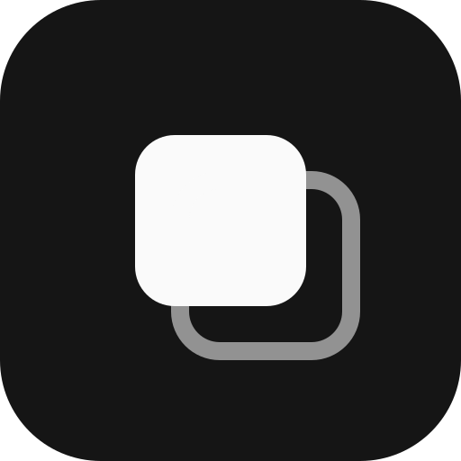

<p align="center">
  
</p>

<h1 align="center">mindblow · site</h1>

<p align="center">A página do <a href="https://github.com/mindblow-org/desktop">mindblow</a>, feita para parecer o próprio app.</p>

O site é o grid do app: um sticky com o logo, a nota de download, notas curtas explicando o que é e um board com o passo a passo. Dá para arrastar os cards, fixar no alfinete, filtrar por tipo, abrir as notas em abas, criar um sticky no `+` e rabiscar no board. A nota "Experimente aqui" vai se marcando conforme a pessoa faz cada coisa.

HTML, CSS e JS puros, sem build e sem dependência. As cores, os raios, as sombras e a curva de animação são os mesmos de `web/src/app.css` do app, e claro e escuro seguem o sistema.

## Rodar

```sh
python3 -m http.server 5399   # http://localhost:5399
```

## Arquivos

- `index.html`: os cards do grid e as notas abertas, uma `section.view` por nota
- `style.css`: tokens do app, barra de abas, grid, notas abertas e board
- `app.js`: grid masonry com drag, filtro, abas, board e download
- `assets/`: ícone e prints do app

O sticky aberto não tem HTML próprio: o `app.js` monta a tela a partir do card. Para pôr uma nota nova no grid, basta um `article.card` com `data-id`, `data-kind` e `data-title`; se não for sticky, junto vai uma `section.view` com o mesmo `data-view`.

Cada nota abre por link: `#baixar`, `#como-funciona`, `#o-que-e`.

## Download

A nota de download escolhe o instalador pelo sistema (AppImage no Linux, `-setup.exe` no Windows) e busca a release mais recente na API do GitHub para atualizar links, tamanhos e versão, com cache de uma hora. Sem rede, ficam os links da v0.2.0 escritos no HTML.

## Publicar

É um site estático, então serve em qualquer hospedagem de arquivos. No GitHub Pages: Settings → Pages → branch `main`, pasta `/`.

## Licença

[MIT](LICENSE)
